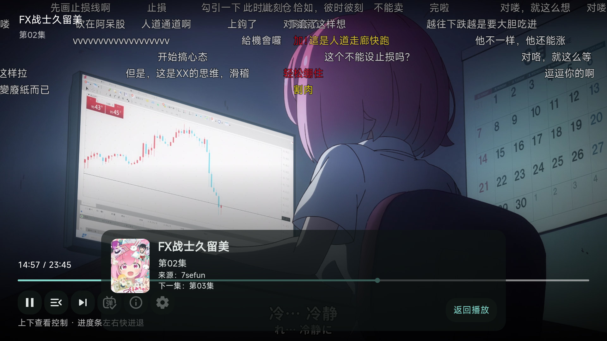
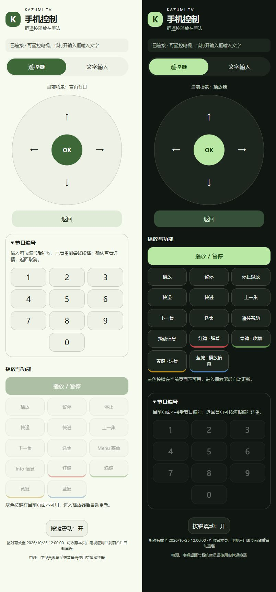

# KazumiTV

为 Android TV 和遥控器设计的动画浏览与播放应用。
基于 **[Predidit/Kazumi](https://github.com/Predidit/Kazumi)**：延续上游的 Flutter/Dart 业务、规则与 media-kit 播放能力，结合本仓库原生 TV 版本的布局和交互工作，形成当前 Flutter TV 融合版。**本项目是独立衍生项目，不是上游官方 TV 版本。**

[下载 0.4.5 正式版](https://github.com/znbsf/KazumiTV/releases/tag/v0.4.5) · [版本记录](CHANGELOG.md) · [构建说明](docs/TV_BUILD_AND_RELEASE.md)

维护入口：[当前项目状态](docs/PROJECT-STATUS.md) · [开发经验](docs/ENGINEERING-LESSONS.md)

## 可以做什么

- **遥控器浏览**：单排横向导航、五列海报卡片、向下持续加载；清晰的焦点高亮，返回时恢复浏览位置。
- **找番与看资料**：分类目录、搜索、排期、作品详情、角色和关联作品。
- **管理播放来源**：导入与管理规则，搜索可用来源，选择线路和剧集。
- **接着看**：收藏、历史记录和分集续播，保留日常追番入口。
- **内置播放**：暂停、进度调整、选集、倍速，以及音轨、字幕和弹幕设置；实际可用能力取决于媒体与来源。

## 电视界面展示

**电视首页 · 手机入口、海报编号与缓存更新时间**


电视首页图来自已验收的r7测试包；截图版本与范围见[截图说明](docs/screenshots/v0.4.4/README.md)。

## 0.4.3 正式版界面

以下截图来自 **v0.4.3 正式包**的 Android TV 实机验收（2026-10-16），不是个人电视/EPG 预览或兼容播放实验。节目资料、弹幕与可播放来源以在线服务的实际返回为准。

**首页 · 最近观看、横向分类与五列海报**


**播放器 · 真实视频画面、弹幕与遥控控制栏**


**INFO · 当前作品、来源与下一集**



截图保留实际界面，仅压缩图片体积；[截图来源与说明](docs/screenshots/v0.4.3/README.md)。截图不代表所有来源、设备或长时间播放均已验证。

## 0.4.5 播放修复

0.4.6 正式版正在准备，包含手机输入补齐、下载可靠性与播放界面性能优化；见[候选说明](docs/RELEASE-0.4.6.md)。当前公开下载仍为 0.4.5。

- 有界跟随后续播放页，并在失败时一次复用近期首帧确认的同集地址缓存。
- 特定 HHJX 补救按实际故障条件判断，正常解析优先，不按 Android/WebView 版本号推测。
- 换源提交和失败回滚保持原 UA/Referer；日志容忍非法百分号编码。
- [发布说明与已测范围](docs/RELEASE-0.4.5.md)。QA/Gecko 实验与规则 overlay 未进入本版。

## 0.4.4 新功能

以下功能已随 **0.4.4** 发布。完整变化见 [0.4.4 发布说明](docs/RELEASE-0.4.4.md)。

- **手机就是遥控器**：从首页打开配对入口，同一局域网扫码使用方向键、确认、返回、播放/暂停、快进退、上下集和选集，也可输入搜索文字。页面随电视应用使用浅色/深色风格，支持可关闭的按键震动。
- **记住配对 7 天**：电视重新打开应用后可从收藏的网址重连；电视显示在线遥控端数量，可暂停全部连接或取消配对。电视 IP 改变可能需要重新扫码；配对有效期不代表后台保活或待机唤醒。
- **编号选番、直接续播**：首页输入海报编号后稍候，已看番剧尝试续播，无记录则进入详情。主动按确认始终查看详情。播放器选集面板闲置3秒自动收起，操作时重新计时。
- **GitHub 应用更新**：正式版自动读取本仓库 Release 和对应架构下载链接，下载后校验，并由系统提示确认安装。
- **首页缓存与刷新**：先显示缓存，冷启动后台刷新；也可手动刷新。失败时保留旧内容和更新时间。
- **源健康探测（实验功能）**：可选择将成功来源用于其他番剧的首次选源；先搜索当前作品，未命中或失败返回普通选源，已有观看记录优先续播。
- **故障更容易排查**：解析超时、资源请求错误和播放器异常留下带会话标识的脱敏记录，重试后仍可回查；记录错误不代表自动修复所有来源。

**手机遥控 · 浅色首页与深色播放控制**



手机图是实际网页代码的浏览器场景预览；场景数据与范围见[截图说明](docs/screenshots/v0.4.4/README.md)。

## 下载与安装

当前正式版：**0.4.5**。需要 **Android 7.0/API 24 或更新版本**，按系统 ABI 选择 APK。

0.4.5 修复有界后续播放页解析、特定 HHJX 故障补救、换源请求头快照与日志容错；保留 0.4.4 的手机遥控与 GitHub 应用更新。完整范围和验收边界见 [0.4.5 发布说明](docs/RELEASE-0.4.5.md)。

| 安装包 | 适用系统 |
|---|---|
| [ARMv7](https://github.com/znbsf/KazumiTV/releases/download/v0.4.5/KazumiTV-0.4.5-armeabi-v7a.apk) | 32 位 ARM Android |
| [ARM64](https://github.com/znbsf/KazumiTV/releases/download/v0.4.5/KazumiTV-0.4.5-arm64-v8a.apk) | 64 位 ARM Android |
| [x86_64](https://github.com/znbsf/KazumiTV/releases/download/v0.4.5/KazumiTV-0.4.5-x86_64.apk) | x86_64 Android / 模拟器 |

1. 下载并侧载 APK，在启动器打开 **KazumiTV**。
2. 首次启动按引导准备规则与播放来源，再从作品详情选择来源和剧集。
3. 方向键移动、确认选择、返回关闭面板或回到上页；播放进度可用左右键调整。

包名为 `com.znbsf.kazumi.fluttertv`。从 **0.4.0 起固定使用正式发布证书**；已安装 `0.4.0-preview.1` 的用户需先卸载预览版再安装，预览版数据不会保留。后续正式版沿用同一证书。
它与原生版、Legacy 和实验版并存；不自动迁移这些旧应用的收藏或历史，详见[数据说明](docs/TV_DATA_MIGRATION.md)。0.4.4 起支持应用内更新：从本仓库 GitHub 正式 Release 自动选择系统支持的 APK，校验哈希、包名、版本与签名后，由你确认系统安装。0.4.3 首次升级仍需从 Release 手动下载安装；QA/preview 不参与正式更新。

## 已知限制

- 来源可能失效、超时或需要验证；目录有作品不保证存在可用播放线路。部分番剧元数据可能遇到连接超时。
- 页面仍可能有长帧，不承诺所有设备60fps。音画确认仅覆盖实测小米电视及所测内容，未进行整集长播或全站点兼容验收。
- 各版本的候选设备回归、正式签名与升级验收分别记录；ARM64/x86_64 不宣称实机通过，参见当前发布说明。

## 问题反馈与日志

请使用本仓库的 [Bug 反馈表单](https://github.com/znbsf/KazumiTV/issues/new?template=1-bug.yml)。填写应用版本及安装包来源、电视/盒子型号、系统版本、复现步骤和预期结果。播放问题还请说明来源名称、线路、集数，以及失败发生在解析、等待首帧还是已经播放之后；无需提供完整播放链接。

### 从应用内获取

1. 出错后先记下时间及所在时区、最后一次操作。先保留日志，再重试；获取前不要点击「清空日志」、清除应用数据或卸载。
2. 打开 **设置 → 存储与日志 → 错误日志**，选择 **复制日志**。电视首页的「设置」会先进入「我的」页，再点右上角「设置」进入分类设置；「存储与日志」在左侧靠下的「其他」分组中。当前日志入口不在「关于」页。
3. 在能够使用该设备剪贴板的编辑器或浏览器中粘贴，检查并脱敏后提交；较长内容可保存为 `.txt` 附件。电视剪贴板不会自动同步到手机或电脑，当前日志页也没有跨设备导出按钮。无法导出时，先附错误日志截图并说明情况，仍可提交 Issue。

普通模式会保存警告、错误及主动持久化的播放诊断，不是全部运行日志。日志为空或缺少某段信息不表示故障没有发生；先提交现有证据，无需默认开启播放器调试模式。

### 日志文件位置

文件名为 `kazumi_logs.log`，程序使用的路径是 `getApplicationSupportDirectory()/logs/kazumi_logs.log`。

- Android 正式包、默认用户的通常路径：`/data/user/0/com.znbsf.kazumi.fluttertv/files/logs/kazumi_logs.log`，部分系统也显示为 `/data/data/com.znbsf.kazumi.fluttertv/files/logs/kazumi_logs.log`。
- QA、实验包或其他系统用户的包名/用户目录可能不同；桌面系统的应用支持目录也由平台决定。优先使用应用内入口，勿按某台开发电脑的绝对路径查找。

Android 上这是应用私有文件，普通文件管理器和 `adb pull` 通常无权读取，正式 Release 包也通常不支持 `run-as`。路径用于识别文件，不需要为反馈问题获取 root、卸载或改装调试包。

### 闪退、卡死或无法进入日志页时

如果已有获授权的 ADB 连接，可在故障后尽快从电脑保存系统日志。先用 `adb devices` 查看目标，将下面的 `DEVICE_SERIAL` 替换为对应设备标识；输出文件保存在电脑当前目录：

```powershell
adb devices
adb -s DEVICE_SERIAL logcat -d -v threadtime > kazumitv-logcat.txt
```

这会导出设备当前保留的系统日志，不会清空缓冲，也不是复制 `kazumi_logs.log`。系统日志可能已被覆盖，并可能包含其他应用信息：本地保留原件，只提交与故障时间、KazumiTV 进程或系统崩溃相关的必要片段。没有 ADB 连接时，直接说明「无法获取系统日志」即可。

Issue 和附件公开可见。提交前删除 token、Cookie、账号信息、完整播放 URL（尤其签名参数）、设备标识及私有地址。播放器调试日志和系统日志不能假定已自动脱敏；无法安全处理时，仅提供现象、时间和截图。

## 来源与许可

感谢 [Predidit/Kazumi](https://github.com/Predidit/Kazumi) 及其贡献者，以及 [media-kit](https://github.com/media-kit/media-kit)、[Bangumi](https://bangumi.tv/) 和[弹弹play](https://www.dandanplay.com/) 等项目与服务。
代码遵循 [GPL-3.0](LICENSE)，保留上游版权和许可；第三方依赖及资源按各自许可使用，详见 [NOTICE](THIRD_PARTY_NOTICES.md)。MiSans 字体版权归 Xiaomi Inc.，遵循其字体协议。节目海报、资料和媒体归各自权利人，本项目不托管影视资源。

[原生 0.3.3](https://github.com/znbsf/KazumiTV/releases/tag/v0.3.3)、[Flutter Legacy](https://github.com/znbsf/KazumiTV/releases/tag/v2.3.1-tv-legacy.1) 与 [0.4.0 预览版](https://github.com/znbsf/KazumiTV/releases/tag/tv-fusion-v0.4.0-preview.1)继续保留；原生[完整源码](https://github.com/znbsf/KazumiTV/tree/24bc50ef47af5e32907ed54413e1eb33c1fb601e)及[历史文档](native-history/README.md)可独立查阅。
